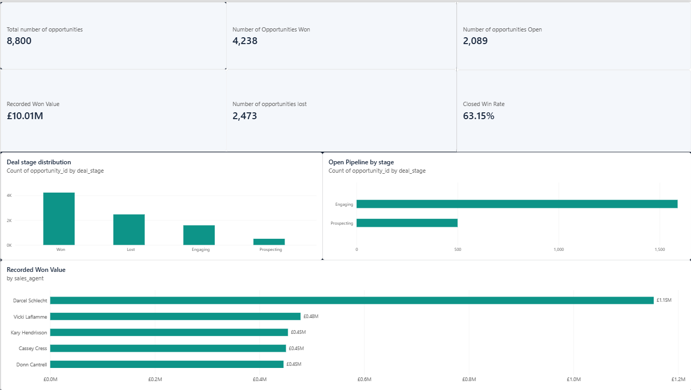
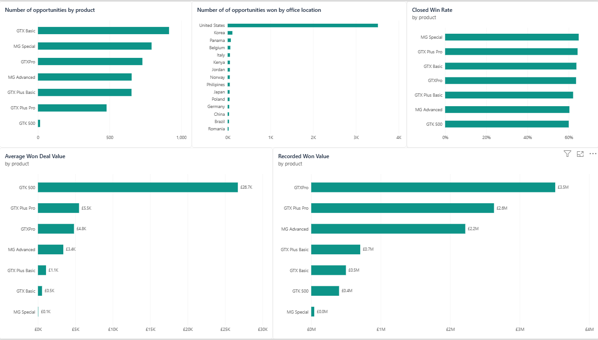
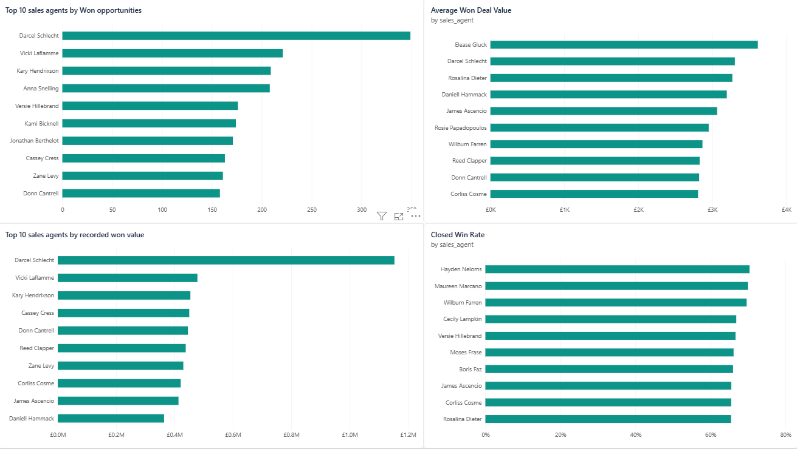
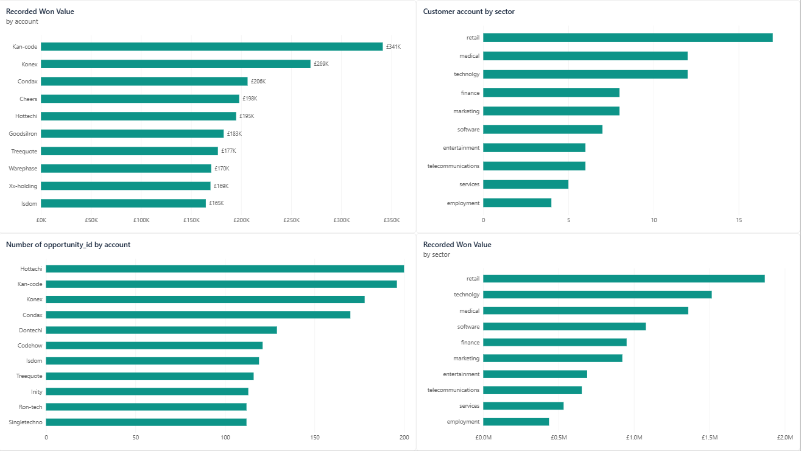
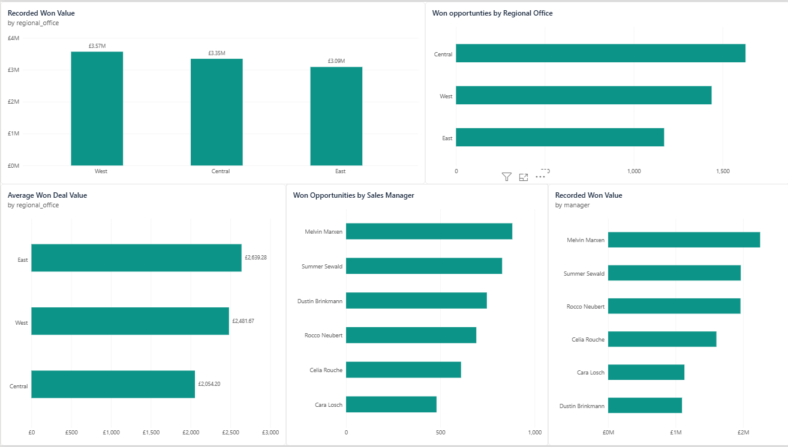
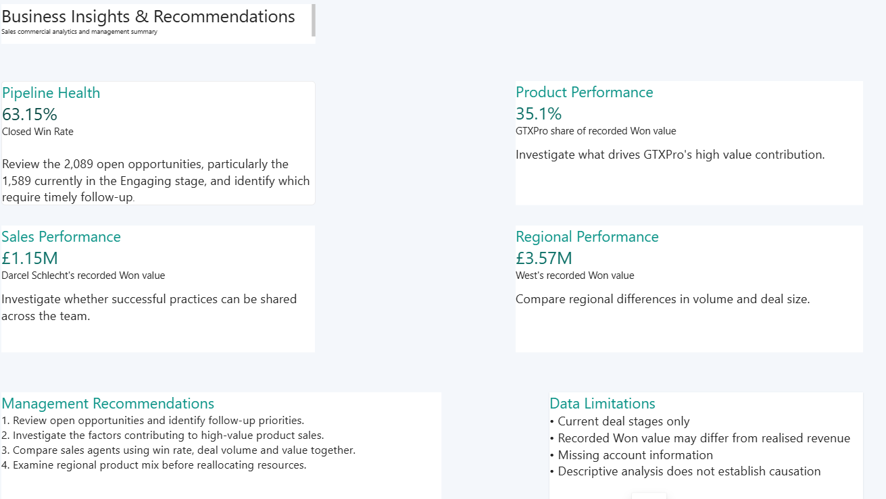

# Sales Commercial Analytics | Python & Power BI

## Project Overview

This project analyses a B2B sales pipeline to understand how effectively opportunities are converted into recorded won value, which products and sales agents contribute most, and how performance varies across accounts, customer sectors, and regional teams.

I used **Python (Pandas)** to explore and analyse the data, then developed a **six-page Power BI report** to communicate the findings and provide recommendations for sales management.

## Business Problem

**How effectively is the company converting its sales pipeline into won deals, and which products, people, customers, and regions are associated with stronger sales outcomes?**

The analysis addresses these questions:

- What is the distribution of won, lost, and open opportunities?
- Which products generate the most recorded won value?
- How do sales agents compare in deal volume, value, average deal size, and closed win rate?
- Which customer accounts and sectors contribute most?
- How does performance differ across regional offices and sales managers?
- Where should management focus further investigation or follow-up?

## Tools and Skills

- **Python / Pandas:** data exploration, missing-value analysis, filtering, aggregation, grouping, merging, and KPI calculations
- **Jupyter Notebook:** reproducible exploratory analysis
- **Power BI:** data modelling, table relationships, DAX measures, interactive visuals, and dashboard design
- **Business analysis:** interpreting KPIs, comparing performance, identifying limitations, and making evidence-based recommendations

## Data

The project uses five related CSV files:

| File | Description |
| --- | --- |
| `sales_pipeline.csv` | Sales opportunities, agents, products, deal stages, dates, and close values |
| `sales_teams.csv` | Sales agents, managers, and regional offices |
| `accounts.csv` | Customer accounts, sectors, company size, and office locations |
| `products.csv` | Product information and prices |
| `data_dictionary.csv` | Field descriptions |

The main sales pipeline contains **8,800 opportunities**. The account and sales team tables were linked to the pipeline to analyse performance across business dimensions.

## Analytical Approach

1. Inspected dataset structure, data types, and missing values.
2. Investigated missing fields by deal stage to understand whether blanks were expected.
3. Calculated pipeline metrics, including won/lost/open counts, closed win rate, recorded won value, and average won deal value.
4. Compared products, agents, accounts, sectors, regions, and managers using Pandas.
5. Loaded the source CSV files into Power BI and created relationships between the relevant tables.
6. Built DAX measures and visualisations to communicate results.
7. Summarised key insights, follow-up questions, recommendations, and limitations.

## Key Findings

| Metric | Result |
| --- | ---: |
| Total opportunities | 8,800 |
| Won opportunities | 4,238 |
| Lost opportunities | 2,473 |
| Open opportunities | 2,089 |
| Closed win rate | 63.15% |
| Recorded won value | £10,005,534 |
| Average won deal value | £2,360.91 |

**Pipeline health:** Of the 2,089 open opportunities, **1,589** are in the *Engaging* stage. These opportunities warrant further review, although the dataset does not establish how long they have been in that stage.

**Product performance:** **GTXPro** contributes approximately **35.1%** of recorded won value (£3.51M). **GTX Basic** has the highest number of won opportunities (915). **GTK 500** has the highest average won deal value, but this is based on only 15 won opportunities.

**Sales performance:** **Darcel Schlecht** has the highest recorded won value (approximately **£1.15M**) and the most won opportunities (349). Different agents lead on other metrics, showing why performance should not be judged by total value alone.

**Customer performance:** **Kan-code** contributes the highest recorded won value among customer accounts (£341,455). The top five accounts collectively contribute approximately **12.1%** of recorded won value.

**Regional performance:** The **West** office has the highest recorded won value (approximately **£3.57M**); **Central** has the most won opportunities (1,629); and **East** has the highest average won deal value (approximately **£2,639**).

## Power BI Dashboard

The report contains six pages:

1. **Executive Overview** — pipeline KPIs, deal stages, open opportunities, and major value contributors
2. **Product Performance** — product volume, win rate, average won deal value, and total won value
3. **Sales Performance** — agent comparisons across won volume, won value, average deal size, and closed win rate
4. **Account Performance** — customer accounts and sector comparisons
5. **Regional and Manager Performance** — regional offices and sales manager comparisons
6. **Business Insights & Recommendations** — management summary, follow-up priorities, and data limitations

### Dashboard Screenshots

#### Executive Overview


#### Product Performance


#### Sales Performance


#### Account Performance


#### Regional and Manager Performance


#### Business Insights & Recommendations


## Management Recommendations

1. **Review open opportunities:** Prioritise follow-up on open deals, especially those in the Engaging stage, using additional information such as deal age and recent contact activity where available.
2. **Investigate high-value product performance:** Examine why GTXPro contributes a large share of recorded won value and whether the drivers are repeatable.
3. **Evaluate sales agents using multiple KPIs:** Consider win rate, deal volume, total won value, and average won deal value together rather than relying on one ranking.
4. **Explore regional differences:** Compare product mix, opportunity volume, and deal size before making staffing or resource-allocation decisions.

## Data Limitations

- The dataset provides **current deal stages**, not a full stage-change history; therefore, detailed stage-to-stage conversion or time-in-stage cannot be established.
- **Recorded won value** should not automatically be treated as realised or collected revenue.
- Some account information is missing, particularly for open opportunities.
- Comparisons are descriptive; they do not prove that an agent, product, or region caused a particular outcome.
- Results from very small groups, such as GTK 500's 15 won opportunities, should be interpreted cautiously.

## Repository Structure

```text
Sales-Commercial-Analytics/
├── data/
│   ├── accounts.csv
│   ├── data_dictionary.csv
│   ├── products.csv
│   ├── sales_pipeline.csv
│   └── sales_teams.csv
├── Notebook/
│   └── 01_initial_exploration.ipynb
├── PowerBi/
│   └── Sales_Commercial_Analytics.pbix
├── images/
│   ├── executive-overview.png
│   ├── product-performance.png
│   ├── sales-performance.png
│   ├── account-performance.png
│   ├── regional-manager-performance.png
│   └── business-insights-recommendations.png
└── README.md
```


## How to Explore the Project

1. Open the Jupyter notebook in `Notebook/` to review the Python exploration and analysis.
2. Open the `.pbix` report in `PowerBi/` using Power BI Desktop to explore the visuals and measures.
3. View the dashboard screenshots above for a quick overview of the completed report.

## Conclusion

This project demonstrates an end-to-end business analytics workflow: examining data quality, calculating performance metrics, connecting related datasets, developing Power BI dashboards, and translating results into practical management questions and recommendations.
